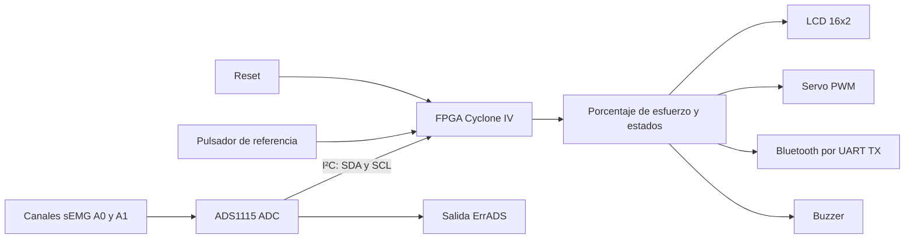

# 1. MYO: Prototipo basado en electromiografía de superficie


Este repositorio documenta la arquitectura digital del prototipo **MYO**, desarrollado para medir y visualizar de manera objetiva la actividad muscular durante ejercicios de rehabilitación. El código procede del archivo `ProyectoMYO_Pru1.v` exportado desde Digital y se presenta en 28 módulos Verilog.

## 2. Introducción

### 2.1. Planteamiento del problema

En fisioterapia, la intensidad de un ejercicio puede estimarse a partir de la percepción de esfuerzo del paciente y de la observación del terapeuta. Sin una medición objetiva, existe riesgo de sobreesfuerzo, de una intensidad insuficiente o de no detectar una compensación muscular. La propuesta de MYO plantea obtener datos de electromiografía de superficie (*surface electromyography*, sEMG) para apoyar el seguimiento de una sesión de rehabilitación [1], [2].

### 2.2. Solución propuesta

MYO recibe señales analógicas de dos canales sEMG mediante un convertidor ADC **ADS1115**; una FPGA procesa las muestras, calcula un porcentaje de esfuerzo respecto a un valor de referencia capturado mediante pulsador y activa distintas salidas: **pantalla LCD 16×2, servomotor PWM, transmisión UART para Bluetooth y buzzer**.

El canal secundario se utiliza en la lógica de **detección de posible compensación muscular**, que genera una indicación o alarma cuando se supera un umbral implementado. La propuesta contempla registrar datos de las sesiones; en este código se observa transmisión de muestras por UART.

### 2.3. Objetivo general

Desarrollar un prototipo funcional que permita medir y visualizar de manera objetiva el esfuerzo muscular durante ejercicios de rehabilitación mediante sensores sEMG.

### 2.4. Objetivos específicos

- Capturar la actividad eléctrica muscular mediante dos entradas del ADS1115.
- Procesar el esfuerzo del canal principal y compararlo con una referencia capturada por el usuario.
- Visualizar niveles de esfuerzo y alertas en pantalla LCD.
- Activar mecanismos de salida que representen esfuerzo y posible compensación.
- Enviar datos por UART para su posible registro externo.

### 2.5. Impacto social

El propósito es aportar información cuantitativa complementaria a la evaluación del terapeuta, ofrecer retroalimentación comprensible a las personas que se rehabilitan y apoyar el seguimiento del esfuerzo muscular. Estos son **beneficios esperados**, sujetos a validación experimental y clínica.

## 3. Arquitectura implementada

### 3.1. Vista general del flujo



```text
MYO-FPGA/
├── README.md
├── diagramas/
│   └── arquitectura_digital.png
├── documentacion/
│   ├── propuesta_original.pdf
│   ├── entradas_y_procesamiento.md
│   ├── procesamiento_completo.md     # Código completo por bloque
│   ├── procesamiento/               # 7 guías con código
│   ├── guia_github_desde_cero.md
│   ├── listado_modulos.md
│   └── salidas/
│       ├── 01_lcd.md
│       ├── 02_servomotor.md
│       ├── 03_bluetooth.md
│       └── 04_buzzer.md
├── rtl/
│   ├── top/                      # Top original y top alternativo modular
│   ├── entradas/                 # I2C ADS1115 y pines de drenador abierto
│   ├── procesamiento/            # 7 bloques nuevos + operadores aritméticos
│   ├── comunes/                  # Registros, contadores, multiplexores, etc.
│   └── salidas/
│       ├── 01_lcd/               # Control LCD + submódulos propios
│       ├── 02_servomotor/        # PWM para servomotor
│       ├── 03_bluetooth/         # UART + submódulos de paquetes
│       └── 04_buzzer/            # Alarma acústica
├── lista_fuentes_modular.f
├── verificacion/
│   └── verificar_integridad.py
├── lista_fuentes.f
├── Makefile
└── respaldo_codigo_original.v
```


### 3.3. Entradas, pulsadores y adquisición I²C

Las entradas principales de MYO son **A0 y A1 (sensores sEMG)**, los botones digitales **`Reset` y `Pulsador`**, y el reloj **`CLk` de 50 MHz**.

#### 3.3.1. ADS1115: sensores principal y secundario

- **A0 / `sensor1[11:0]`:** lectura del sensor muscular principal, convertida por el ADS1115.
- **A1 / `sensor2[11:0]`:** lectura secundaria para la regla de posible compensación.
- **SDA y SCL:** comunicación I²C controlada por [`ADS1115_I2C`](ADS1115_I2C.v).
- **Señales `Valid1` / `Valid2`:** indican cuándo se debe retener una conversión válida.
- **Salida `ErrADS`:** indica un error notificado por el controlador I²C.


#### 3.3.2. Pulsador Reset y pulsador de referencia

- **`Reset`:** reinicio activo en alto que se sincroniza en dos flip-flops para generar `rst`, y borra la referencia almacenada.
- **`Pulsador`:** sincroniza su flanco de subida para producir `BtnPul` y guardar la muestra principal como `VlrMax`.
- **`CLk`:** señal de reloj FPGA, 50 MHz.


### 3.4. Procesamiento: código Verilog de cada bloque

En el circuito original esta lógica está integrada en [`ProyectoMYO`](ProyectoMYO.v).

#### 3.4.1. Sincronización y detección de pulsadores

Archivo: [`Entradas`](Entradas.v). Usa cinco flip-flops para sincronizar `Reset`, sincronizar `Pulsador` y detectar el flanco de subida. El reset también habilita el borrado de `VlrMax`.


#### 3.4.2. Generador de pulsos de procesamiento

Archivo: [`Generador_Pulso`](Generador_de_Pulso.v). Con reloj de **50 MHz** y cuenta de `0` hasta `499999`, genera un pulso cada **10 ms** (100 Hz). 

#### 3.4.3. Registro y actualización de los sensores

Archivo: [`Registro_Sensores`](Registro_Sensores.v). Guarda la última conversión de cada sensor con `Valid1`/`Valid2`; luego actualiza las muestras de procesamiento cuando aparece `Pulso`.


#### 3.4.4. Captura de la referencia muscular

Archivo: [`Captura_Referencia`](Captura_de_Referencia.v). Registra `VlrMax` al pulsar y guarda cero cuando `rst=1`.

#### 3.4.5. Cálculo del porcentaje de esfuerzo

Archivo: [`Calculo_Porcentaje`](Calculo_Porcentajes.v). Calcula la división entera:

```text
Porcentaje = (100 * DatoPrincipal) / VlrMax
```

Si `VlrMax=0`, se fuerza numerador a cero y divisor a uno. El producto original se limita a sus 19 bits inferiores; la implementación mantiene este ancho.

#### 3.4.6. Cálculo de segmentos para LCD y niveles del servo

Archivo: [`Escalado_Segmentos`](Division_Pasos_Segmentos.v). Se limita el porcentaje a 100 para los dos indicadores:

```text
LCD16   = floor(min(Porcentaje, 100) * 16 / 100)   // 0 a 16
Servo15 = floor(min(Porcentaje, 100) * 15 / 100)   // 0 a 15
Prc     = Porcentaje[7:0]  // dato de 8 bits para LCD
```

Cuando el porcentaje supera 255, `Prc` puede representar solo sus ocho bits bajos, igual que en el código original.

#### 3.4.7. Definición de estados del sistema

Archivo: [`Clasificador_Estados`](Definicion_Estados_completo.v).

| Estado | Señal | Condición digital |
|---|---|---|
| Normal | `En_Nor` | referencia válida y porcentaje <80 |
| Precaución | `En_Pre` | 80 ≤ porcentaje <100 |
| Límite | `En_Lim` | porcentaje =100 |
| Excedido | `En_Exc` | porcentaje >100 |
| Posible compensación | `En_Com` | referencia válida y lectura secundaria ≥3000 |

**Nota:** la compensación es un umbral digital fijo. `En_Com` puede coexistir con otro estado de esfuerzo.

### 3.5. Salidas: cada una con su propio código

#### A. Pantalla LCD

[`LCD`](LCD.v) incluye el módulo `Mod_LCD_F` y sus componentes particulares. La salida de 4 bits utiliza los pines `E`, `Rs`, `Rw`, `D4`, `D5`, `D6`, `D7`.

#### B. Servomotor

[`Servomotor`](Servomotor.v) genera la señal `PWM` a partir de la magnitud limitada a 100 %, escalada a una entrada de 4 bits (0–15). El período del contador equivale a aproximadamente 20 ms a 50 MHz; se calcula un pulso en función del valor digital. 

#### C. Bluetooth

[`Bluetooth`](Bluetooth.v) contiene `Mod_Blue`, `UART_COMPLETO`, `CONTROL_PAQUETES`, `TEMPORIZADOR_ENVIO`, `REGISTROS_TX`, `SEPARADOR_12_A_8` y `Decoder3`. La salida `UART` transmite datos de 12 bits en dos bytes, con un indicador de tipo de dato en el bit más alto del byte alto. La configuración del divisor corresponde aproximadamente a **9600 baudios** con un reloj de 50 MHz. El código implementa **TX UART**.

#### D. Buzzer

[`Buzzer`](Buzzer.v) controla `Buzz` cuando existe condición de esfuerzo excedido (`EXC`) o compensación (`COM`). La salida es **activa en nivel bajo** según la asignación del código.

### 3.6. Puertos principales

| Puerto | Dirección | Función |
|---|---|---|
| `CLk` | Entrada | Reloj de FPGA de 50 MHz |
| `Reset` | Entrada | Pulsador/entrada de reinicio sincronizada |
| `Pulsador` | Entrada | Captura del valor de referencia |
| `sda`, `scl` | Bidireccional | Bus I²C ADS1115 |
| `PWM` | Salida | Control del servomotor |
| `E`, `Rs`, `Rw`, `D4`–`D7` | Salida | Interfaz LCD |
| `UART` | Salida | TX serie hacia módulo Bluetooth |
| `Buzz` | Salida | Alarma acústica |
| `ErrADS` | Salida | Error reportado por ADS1115/I²C |


## 4. Conclusiones

El proyecto MYO integra adquisición de dos canales por ADS1115/I²C, procesamiento digital en una FPGA y cuatro interfaces de retroalimentación: LCD, PWM para servo, UART para Bluetooth y buzzer. El diseño permite representar el esfuerzo como un porcentaje relativo a una referencia capturada y disparar alertas con criterios digitales definidos en el código.

La separación en 28 archivos originales y siete bloques de procesamiento adicionales mejora la **trazabilidad, lectura y mantenimiento** sin alterar las definiciones originales. Para completar su validación hacen falta pruebas reales del sistema, calibración de sensores, elección de pines, pruebas de robustez y verificación experimental de los umbrales de esfuerzo y compensación. No se puede inferir eficacia terapéutica únicamente del código.

## 5. Bibliografía

[1] Easy Fisioterapia, “¿Cómo rehabilitar una lesión muscular?”, 14 de noviembre de 2024. [En línea](https://easyfisioterapia.com/blog/como-rehabilitar-una-lesion-muscular/).

[2] M. Chmiel, “A Comprehensive Guide to Exercise Parameters in Physical Therapy”, Physitrack, 8 de mayo de 2025. [En línea](https://www.physitrack.com/insights/a-comprehensive-guide-to-exercise-parameters-in-physical-therapy).

