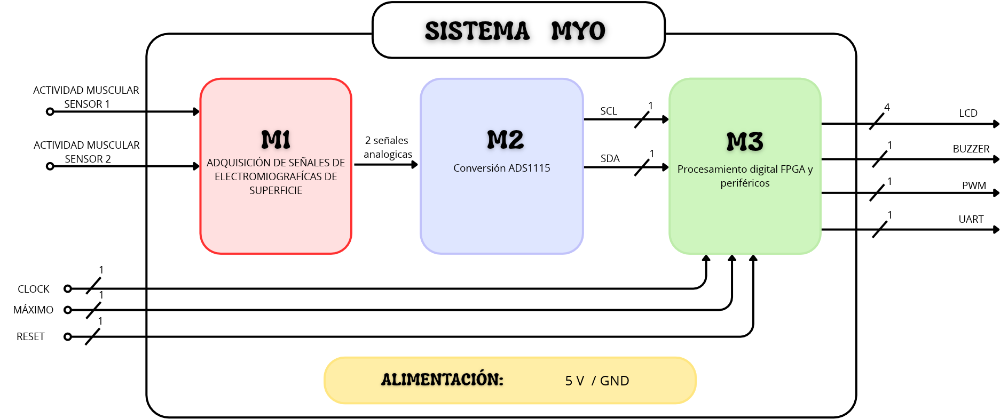
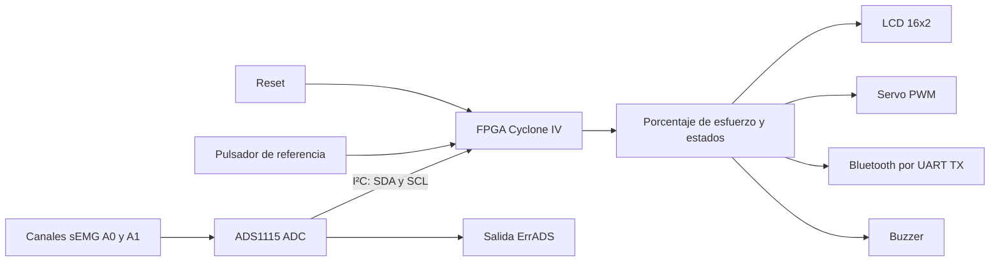

# 1. MYO: Prototipo basado en electromiografía de superficie



Este repositorio documenta la arquitectura digital del prototipo **MYO**, desarrollado para medir y visualizar de manera objetiva la actividad muscular durante ejercicios de rehabilitación. El código procede del archivo `ProyectoMYO_Pru1.v` exportado desde Digital y se presenta en **28 módulos Verilog separados**, manteniendo intacto el contenido de cada definición de módulo.

## 2. Introducción

### 2.1. Planteamiento del problema

En fisioterapia, la intensidad de un ejercicio puede estimarse a partir de la percepción de esfuerzo del paciente y de la observación del terapeuta. Sin una medición objetiva, existe riesgo de sobreesfuerzo, de una intensidad insuficiente o de no detectar una compensación muscular. La propuesta de MYO plantea obtener datos de electromiografía de superficie (*surface electromyography*, sEMG) para apoyar el seguimiento de una sesión de rehabilitación [1], [2].

### 2.2. Solución propuesta

MYO recibe señales analógicas de dos canales sEMG mediante un convertidor ADC **ADS1115**; una FPGA procesa las muestras, calcula un porcentaje de esfuerzo respecto a un valor de referencia capturado mediante pulsador y activa distintas salidas: **pantalla LCD 16×2, servomotor PWM, transmisión UART para Bluetooth y buzzer**.

El canal secundario se utiliza en la lógica de **detección de posible compensación muscular**, que genera una indicación o alarma cuando se supera un umbral implementado. La propuesta contempla registrar datos de las sesiones; en este código se observa transmisión de muestras por UART.

### 2.3. Objetivo general

Desarrollar un prototipo funcional que permita medir y visualizar de manera objetiva el esfuerzo muscular durante ejercicios de rehabilitación mediante sensores sEMG.

### 2.4. Objetivos específicos

- Capturar la actividad eléctrica muscular mediante dos entradas del ADS1115.
- Procesar el esfuerzo del canal principal y compararlo con una referencia capturada por el usuario.
- Visualizar niveles de esfuerzo y alertas en pantalla LCD.
- Activar mecanismos de salida que representen esfuerzo y posible compensación.
- Enviar datos por UART para su posible registro externo.

### 2.5. Impacto social

El propósito es aportar información cuantitativa complementaria a la evaluación del terapeuta, ofrecer retroalimentación comprensible a las personas que se rehabilitan y apoyar el seguimiento del esfuerzo muscular. Estos son **beneficios esperados**, sujetos a validación experimental y clínica.

## 3. Arquitectura implementada

### 3.1. Vista general del flujo



**Módulo superior:** [`ProyectoMYO_Pru1`](ProyectoMYO_Pru1.v). Integra el ADC, los registros de muestras, la temporización, el cálculo del porcentaje y las salidas. El procesamiento principal **está descrito dentro del archivo superior**.
### 3.2. Estructura de archivos

```text
MYO-FPGA/
├── README.md
├── diagramas/
│   └── arquitectura_digital.png
├── documentacion/
│   ├── propuesta_original.pdf
│   ├── entradas_y_procesamiento.md
│   ├── guia_github_desde_cero.md
│   ├── listado_modulos.md
│   └── salidas/
│       ├── 01_lcd.md
│       ├── 02_servomotor.md
│       ├── 03_bluetooth.md
│       └── 04_buzzer.md
├── rtl/
│   ├── top/                      # Integración y clasificación
│   ├── entradas/                 # I2C ADS1115 y pines de drenador abierto
│   ├── procesamiento/            # Operaciones aritméticas auxiliares
│   ├── comunes/                  # Registros, contadores, multiplexores, etc.
│   └── salidas/
│       ├── 01_lcd/               # Control LCD + submódulos propios
│       ├── 02_servomotor/        # PWM para servomotor
│       ├── 03_bluetooth/         # UART + submódulos de paquetes
│       └── 04_buzzer/            # Alarma acústica
├── verificacion/
│   └── verificar_integridad.py
├── lista_fuentes.f
├── Makefile
└── respaldo_codigo_original.v
```

**Para consultar el código individual de cada salida**, abre sus carpetas o documentos:

| Salida | Módulo principal | Descripción y código desglosado |
|---|---|---|
| LCD 16×2 (4 bits) | [`Mod_LCD_F.v`](rtl/salidas/01_lcd/Mod_LCD_F.v) | [LCD: archivos y submódulos](documentacion/salidas/01_lcd.md) |
| Servo PWM | [`Cont_Srv_Con.v`](rtl/salidas/02_servomotor/Cont_Srv_Con.v) | [Servomotor: funcionamiento y código](documentacion/salidas/02_servomotor.md) |
| Bluetooth / UART TX | [`Mod_Blue.v`](rtl/salidas/03_bluetooth/Mod_Blue.v) | [Bluetooth: siete módulos individuales](documentacion/salidas/03_bluetooth.md) |
| Buzzer | [`Mod_Buzzer.v`](rtl/salidas/04_buzzer/Mod_Buzzer.v) | [Buzzer: funcionamiento y código](documentacion/salidas/04_buzzer.md) |

También consulta [entradas y procesamiento](documentacion/entradas_y_procesamiento.md) y el [inventario de los 28 módulos](documentacion/listado_modulos.md).

### 3.3. Entradas y adquisición: ADS1115 por I²C

- **Canal A0:** entrada del sensor muscular principal, conectada a `sensor1[11:0]`.
- **Canal A1:** entrada del sensor muscular secundario, conectada a `sensor2[11:0]`.
- **Interfaz:** SDA bidireccional y SCL de drenador abierto, generados por [`ADS1115_I2C.v`](rtl/entradas/ADS1115_I2C.v) y adaptados a los pines con [`DIG_PinControl_BUS.v`](rtl/entradas/DIG_PinControl_BUS.v).
- **Configuración en el código:** ADS1115 con dirección `0x48` (`ADDR` a GND), reloj FPGA de 50 MHz, I²C próximo a 100 kHz, modo *single-shot* y 860 SPS configurados.
- **Diagnóstico:** `ErrADS` refleja el error detectado por el controlador I²C.

> Las líneas I²C **requieren resistencias pull-up externas** adecuadas. Los dos sensores sEMG deben entregar señales analógicas compatibles con el rango configurado del ADC; el código no incluye el acondicionamiento analógico.

### 3.4. Procesamiento y criterios implementados

El pulsador captura una referencia de 12 bits `VlrMax` a partir de la señal del canal principal procesada en ese momento; el reset borra la referencia. La lógica principal toma muestras en intervalos aproximados de **1 ms** con un contador de 50 MHz y calcula:

```text
porcentaje = (100 × dato_principal) / referencia
```

Si `referencia = 0`, la lógica evita la división por cero y utiliza valor cero para el porcentaje. El valor para LCD sale de los 8 bits menos significativos del cociente; por ello, **valores superiores a 255 pueden desbordar la representación de la pantalla**. Las condiciones implementadas en el módulo superior son:

| Estado | Condición digital |
|---|---|
| Normal | referencia distinta de cero y porcentaje < 80 |
| Precaución | 80 ≤ porcentaje < 100 |
| Límite | porcentaje = 100 |
| Excedido | porcentaje > 100 |
| Posible compensación | referencia distinta de cero y canal secundario ≥ 3000 cuentas |

La compensación se detecta con un **umbral digital fijo**, no con un análisis fisiológico validado ni con una normalización individual del canal secundario.

### 3.5. Salidas: cada una con su propio código

#### A. Pantalla LCD

[`rtl/salidas/01_lcd/`](rtl/salidas/01_lcd/) incluye el módulo `Mod_LCD_F` y sus componentes particulares. La salida de 4 bits utiliza los pines `E`, `Rs`, `Rw`, `D4`, `D5`, `D6`, `D7`. Consulta [submódulos LCD](documentacion/salidas/01_lcd.md).

#### B. Servomotor

[`rtl/salidas/02_servomotor/Cont_Srv_Con.v`](rtl/salidas/02_servomotor/Cont_Srv_Con.v) genera la señal `PWM` a partir de la magnitud limitada a 100 %, escalada a una entrada de 4 bits (0–15). El período del contador equivale a aproximadamente 20 ms a 50 MHz; se calcula un pulso en función del valor digital. Consulta [servo](documentacion/salidas/02_servomotor.md).

#### C. Bluetooth

[`rtl/salidas/03_bluetooth/`](rtl/salidas/03_bluetooth/) contiene `Mod_Blue`, `UART_COMPLETO`, `CONTROL_PAQUETES`, `TEMPORIZADOR_ENVIO`, `REGISTROS_TX`, `SEPARADOR_12_A_8` y `Decoder3`, **cada uno en su propio archivo**. La salida `UART` transmite datos de 12 bits en dos bytes, con un indicador de tipo de dato en el bit más alto del byte alto. La configuración del divisor corresponde aproximadamente a **9600 baudios** con un reloj de 50 MHz. El código implementa **TX UART**: no incluye emparejamiento Bluetooth ni software receptor. Consulta [Bluetooth y sus submódulos](documentacion/salidas/03_bluetooth.md).

#### D. Buzzer

[`rtl/salidas/04_buzzer/Mod_Buzzer.v`](rtl/salidas/04_buzzer/Mod_Buzzer.v) controla `Buzz` cuando existe condición de esfuerzo excedido (`EXC`) o compensación (`COM`). La salida es **activa en nivel bajo** según la asignación del código. Consulta [buzzer](documentacion/salidas/04_buzzer.md).

### 3.6. Puertos principales

| Puerto | Dirección | Función |
|---|---|---|
| `CLk` | Entrada | Reloj de FPGA de 50 MHz |
| `Reset` | Entrada | Pulsador/entrada de reinicio sincronizada |
| `Pulsador` | Entrada | Captura del valor de referencia |
| `sda`, `scl` | Bidireccional | Bus I²C ADS1115 |
| `PWM` | Salida | Control del servomotor |
| `E`, `Rs`, `Rw`, `D4`–`D7` | Salida | Interfaz LCD |
| `UART` | Salida | TX serie hacia módulo Bluetooth |
| `Buzz` | Salida | Alarma acústica |
| `ErrADS` | Salida | Error reportado por ADS1115/I²C |


## 4. Conclusiones

El proyecto MYO integra adquisición de dos canales por ADS1115/I²C, procesamiento digital en una FPGA y cuatro interfaces de retroalimentación: LCD, PWM para servo, UART para Bluetooth y buzzer. El diseño permite representar el esfuerzo como un porcentaje relativo a una referencia capturada y disparar alertas con criterios digitales definidos en el código.

La separación en 28 archivos mejora la **trazabilidad, lectura y mantenimiento** sin modificar las definiciones originales. Para completar su validación hacen falta pruebas reales del sistema, calibración de sensores, elección de pines, pruebas de robustez y verificación experimental de los umbrales de esfuerzo y compensación. No se puede inferir eficacia terapéutica únicamente del código.

## 5. Bibliografía

[1] Easy Fisioterapia, “¿Cómo rehabilitar una lesión muscular?”, 14 de noviembre de 2024. [En línea](https://easyfisioterapia.com/blog/como-rehabilitar-una-lesion-muscular/).

[2] M. Chmiel, “A Comprehensive Guide to Exercise Parameters in Physical Therapy”, Physitrack, 8 de mayo de 2025. [En línea](https://www.physitrack.com/insights/a-comprehensive-guide-to-exercise-parameters-in-physical-therapy).


---

**[Guía paso a paso: publicar este repositorio en GitHub](documentacion/guia_github_desde_cero.md)** · **[Diagrama del circuito](diagramas/arquitectura_digital.png)** · **[Código original](respaldo_codigo_original.v)**
